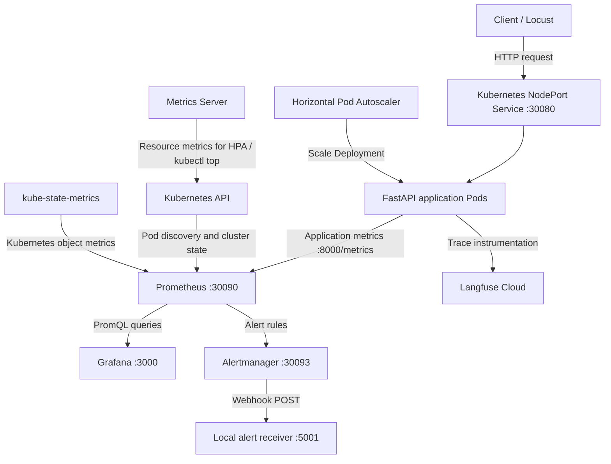

# LLM Observability Platform

A Kubernetes-deployed observability platform for monitoring an AI-style question-answering API. It combines application metrics, distributed tracing, infrastructure monitoring, autoscaling, alerting, and service-level objective (SLO) views in one local development environment.

> **Project status:** Local portfolio project. The API currently returns a mock response; it does not yet call a live LLM provider. Token counts and cost values are estimates derived from text length, not provider-reported usage or actual billing.

## Why this project?

AI-backed services can fail in ways that are difficult to diagnose from application logs alone. A service may respond slowly, return errors, consume more resources than expected, restart repeatedly, or become overloaded as traffic increases.

This project demonstrates how to build an observability workflow around an API:

- Measure request volume, throughput, errors, and latency.
- Track estimated input/output token usage and estimated cost.
- Capture request traces with Langfuse instrumentation.
- Discover Kubernetes application Pods dynamically.
- Monitor Pod health, restarts, Deployment replicas, HPA behavior, CPU, and memory.
- Visualize application and infrastructure signals in Grafana.
- Evaluate example availability and latency SLOs.
- Trigger Prometheus alerts and route notifications through Alertmanager to a local webhook receiver.
- Exercise the service with Locust and observe how Kubernetes responds.

## Architecture



### Request and monitoring flow

1. A client or Locust sends an HTTP request to the Kubernetes NodePort Service.
2. Kubernetes forwards the request to one of the FastAPI application Pods.
3. FastAPI processes the request and updates Prometheus counters and latency histograms.
4. Prometheus discovers eligible application Pods and scrapes their `/metrics` endpoints.
5. Grafana queries Prometheus using PromQL and renders dashboards.
6. Prometheus evaluates alert rules. Firing alerts are sent to Alertmanager.
7. Alertmanager groups and routes notifications to the in-cluster webhook receiver.
8. Kubernetes monitoring metrics and resource metrics provide context about Pod health, scaling, CPU, and memory.
9. Langfuse receives instrumented traces. The current response generation remains mocked.

## Technology stack

| Technology | Role in this project |
|---|---|
| Python 3.12 | Application and test runtime |
| FastAPI | HTTP API and interactive API documentation |
| Prometheus client | Exposes application metrics |
| Prometheus | Scrapes metrics, stores time series, evaluates alert rules, and serves PromQL |
| Grafana | Dashboards and visual analysis |
| Langfuse SDK | LLM-style request tracing/instrumentation |
| Docker | Packages the API into a container image |
| Docker Compose | Runs the initial local container-based stack |
| Kubernetes (Docker Desktop) | Runs and manages the application and monitoring components locally |
| kube-state-metrics | Exposes Kubernetes object-state metrics |
| Metrics Server | Supplies resource metrics used by `kubectl top` and HPA |
| Alertmanager | Groups and routes Prometheus alert notifications |
| Python standard-library HTTP server | Receives Alertmanager webhook notifications |
| Locust | Generates load against the API |
| Pytest | Runs automated application tests |
| Git and GitHub | Source control and repository hosting |
| GitHub Actions | Runs CI checks |
| GitHub Container Registry (GHCR) | Stores the built container image |

## Dashboards

The project includes four Grafana dashboards. Add your actual Grafana screenshots to `docs/images/` using the filenames below. The image references are ready; the screenshots are not fabricated or embedded in this repository automatically.

### 1. LLM Observability Dashboard


Shows application-level API behavior, including total requests, request throughput, errors, average latency, P95 latency, and estimated input/output token rates.

**Why it helps:** Quickly answers whether the API is receiving traffic, how quickly it responds, whether errors are occurring, and how request behavior changes under load.

### 2. Kubernetes Observability Dashboard


Shows running, pending, and failed Pods; Pod restart activity; desired and available Deployment replicas; and HPA current and desired replica counts.

**Why it helps:** Helps identify unhealthy Pods, failed rollouts, restart loops, replica shortages, and autoscaling behavior.

### 3. Kubernetes Resource Monitoring Dashboard


Shows total application CPU usage, total application memory working set, CPU usage per Pod, and memory usage per Pod.

**Why it helps:** Helps investigate resource consumption, compare Pods, identify unusually high CPU or memory use, and understand whether resource limits or scaling settings may need attention.

### 4. LLM Service Level Objectives (SLO) Dashboard


Tracks example rolling seven-day service indicators, including availability, requests completed within one second, estimated availability error-budget remaining, total requests, P95 latency, and successful versus failed requests.

**Why it helps:** Turns raw telemetry into service-level indicators that can be compared with explicit targets. The current demonstration targets are 99% availability and 95% of requests within one second; they are portfolio-demo targets, not contractual production SLAs.

> **SLO data note:** The Kubernetes Prometheus instance has only collected data since it was deployed. A seven-day dashboard range does not create seven days of historical data. The displayed values are based on samples actually available during the selected period. The one-second latency panel also requires a matching histogram bucket boundary; verify the actual `le` label in Prometheus before treating that panel as validated.

## Alerting

Prometheus evaluates these example alert rules:

| Alert | Condition (high-level) | Purpose |
|---|---|---|
| `HighAPIErrorRate` | Error ratio exceeds 5% over the configured evaluation window, with a minimum request volume | Detects elevated API failures |
| `HighAPILatency` | P95 latency exceeds 1 second for the configured duration | Detects slow API responses |
| `ApplicationPodRestart` | Application container restart activity is detected | Flags container instability |
| `ApplicationReplicasUnavailable` | Available Deployment replicas remain below desired replicas | Detects reduced service capacity |
| `HighApplicationCPU` | Application CPU usage exceeds the configured threshold | Flags high CPU consumption |
| `HighApplicationMemory` | Application memory working set exceeds the configured threshold | Flags high memory consumption |

Firing alerts are routed through Alertmanager to a local webhook receiver. The receiver logs the notification payload. This demonstrates the alert delivery path; it is not currently connected to email, Slack, PagerDuty, or another external incident-management service.

## API and local endpoints

The project is configured for local development on Docker Desktop.

| Component | URL | Purpose |
|---|---|---|
| FastAPI application | `http://localhost:30080` | Kubernetes NodePort entry point |
| Health endpoint | `http://localhost:30080/health` | Application health check |
| Metrics endpoint | `http://localhost:30080/metrics` | Prometheus metrics exposition |
| Swagger / OpenAPI docs | `http://localhost:30080/docs` | Interactive API documentation |
| ReDoc | `http://localhost:30080/redoc` | Alternative API documentation |
| Kubernetes Prometheus | `http://localhost:30090` | Prometheus UI and query interface |
| Prometheus targets | `http://localhost:30090/targets` | Scrape target health |
| Prometheus rules API | `http://localhost:30090/api/v1/rules` | Loaded alert rules |
| Prometheus alerts API | `http://localhost:30090/api/v1/alerts` | Current alert state |
| Alertmanager | `http://localhost:30093` | Alert grouping and routing UI |
| Grafana | `http://localhost:3000` | Dashboards |
| Locust | `http://localhost:8089` | Load-test UI |
| Docker Compose Prometheus | `http://localhost:9090` | Original Docker-based Prometheus instance |

Grafana data sources used in the project:

- `Kubernetes-Prometheus`: `http://host.docker.internal:30090`
- Docker Compose Prometheus: `http://prometheus:9090` when Grafana runs in the Compose network.

Langfuse Cloud project: `https://us.cloud.langfuse.com/project` (requires the configured account and credentials).

## Running the project locally

### Prerequisites

- Windows with Docker Desktop and its Kubernetes cluster enabled, or an appropriately configured local Kubernetes environment.
- Python 3.12.
- Git.
- `kubectl`.
- A GitHub account if you want to build and publish the image through the included CI workflow.
- Langfuse credentials only if you want to enable trace export.

### 1. Clone the repository

```bash
git clone https://github.com/preeshita/llm-observability-platform.git
cd llm-observability-platform
```

### 2. Create a Python environment and install dependencies

PowerShell:

```powershell
py -3.12 -m venv .venv
.\.venv\Scripts\Activate.ps1
python -m pip install --upgrade pip
pip install -r requirements.txt
```

### 3. Configure local environment variables

Create a local `.env` file using the variable names expected by the application and Langfuse integration. Obtain your own credentials from the relevant provider. Never commit `.env` or Kubernetes Secret manifests containing credentials.

### 4. Run tests

```powershell
python -m pytest -v
```

### 5. Run with Docker Compose (if using the Compose setup)

```powershell
docker compose up --build -d
docker compose ps
```

Use `docker compose logs -f` to inspect service logs. The Compose setup is the initial container-based development environment; the Kubernetes NodePort URLs in this document refer to the Kubernetes deployment.

### 6. Deploy to Kubernetes

The Kubernetes manifests are under `k8s/`. Review image references and local secret configuration before applying them. Apply the ConfigMap, Secret, application Deployment, Service, HPA, and monitoring manifests in the order described in the project setup notes.

Useful checks:

```powershell
kubectl get pods -A
kubectl get pods -n default
kubectl get svc -A
kubectl get hpa -n default
kubectl top pods -n default
```

Do not commit secret manifests or real credentials. Use your own locally generated Kubernetes Secret.

## Example Prometheus metrics

The application exposes metrics such as:

- `llm_requests_total` — request counter labelled by status.
- `llm_request_latency_seconds` — request latency histogram, exposed as `_bucket`, `_sum`, and `_count` time series.
- `llm_tokens_total` — estimated token counter labelled by token type.
- `llm_errors_total` — application error counter.

Kubernetes monitoring includes kube-state-metrics series such as `kube_pod_status_phase`, `kube_pod_container_status_restarts_total`, Deployment replica metrics, and HPA status metrics. Resource monitoring uses container CPU and memory series exposed through the Kubernetes resource metrics endpoint.

## Repository layout

```text
llm-observability-platform/
├── .github/
│   └── workflows/
│       └── ci.yml
├── k8s/
│   ├── monitoring/
│   ├── app-configmap.yaml
│   ├── app-deployment.yaml
│   ├── app-service.yaml
│   └── app-hpa.yaml
├── monitoring/
│   └── prometheus/
│       ├── prometheus.yml
│       └── alert-rules.yml
├── tests/
├── .dockerignore
├── .gitignore
├── Dockerfile
├── docker-compose.yml
├── locustfile.py
├── main.py
└── requirements.txt
```

The local Kubernetes Secret manifest (`k8s/app-secret.yaml`) and `.env` file are intentionally excluded from source control.

## Current limitations and future improvements

This repository demonstrates an end-to-end local observability design. It is not yet a production-ready managed platform.

- **Mock generation:** The API currently returns a mock answer; connect a real LLM provider for actual inference.
- **Estimated token and cost values:** Current estimates are based on text length. Replace them with provider-reported usage and current model pricing.
- **Trace validation:** Langfuse instrumentation is present, but trace content and completeness should be revalidated when real model calls are integrated.
- **Local Kubernetes:** The cluster runs on Docker Desktop, not a production-managed Kubernetes service.
- **Alert notifications:** Alertmanager currently delivers to a local webhook receiver that logs payloads; external notification channels are future work.
- **Alertmanager persistence:** Its current single-replica setup uses ephemeral storage; state is not preserved through Pod recreation.
- **Metrics Server TLS:** The local Docker Desktop configuration uses `--kubelet-insecure-tls` to make local metrics collection work. This is not an appropriate production security setting.
- **SLO history:** The rolling seven-day views need sufficient retained Prometheus history before they represent a full seven-day window.
- **SLO bucket verification:** The one-second latency SLI must use a histogram bucket boundary that actually exists in the application's exported metrics.

Potential next steps include real provider integration, accurate token/cost accounting, durable monitoring storage, external alert routing, dashboards-as-code, production-grade authentication and secrets management, and deployment to a managed Kubernetes cluster.

## What this project demonstrates

- Instrumenting an API with application metrics and traces.
- Building Prometheus scrape and Kubernetes service-discovery configuration.
- Writing PromQL queries and alert rules.
- Creating Grafana dashboards for application, cluster, resource, and SLO visibility.
- Deploying and scaling a containerized service with Kubernetes.
- Monitoring autoscaling and recovery behavior.
- Routing alert notifications with Alertmanager and a webhook receiver.
- Testing API behavior with Pytest and Locust.
- Automating checks and image publishing with GitHub Actions.

## Screenshots: how to add them

Create the folder `docs/images/` and save screenshots of the four actual Grafana dashboards using these exact names:

```text
docs/images/llm-observability-dashboard.png
docs/images/kubernetes-observability-dashboard.png
docs/images/kubernetes-resource-monitoring-dashboard.png
docs/images/llm-slo-dashboard.png
```

Capture each dashboard in Grafana with a readable time range and no open edit panels. Then commit the image files along with this README. The image links above will render automatically on GitHub once those files exist.

---

## Author

**Preeshita**
GitHub: [@preeshita](https://github.com/preeshita)

This project was developed as a hands-on portfolio project to explore application observability, Kubernetes operations, and monitoring for AI-style services.
